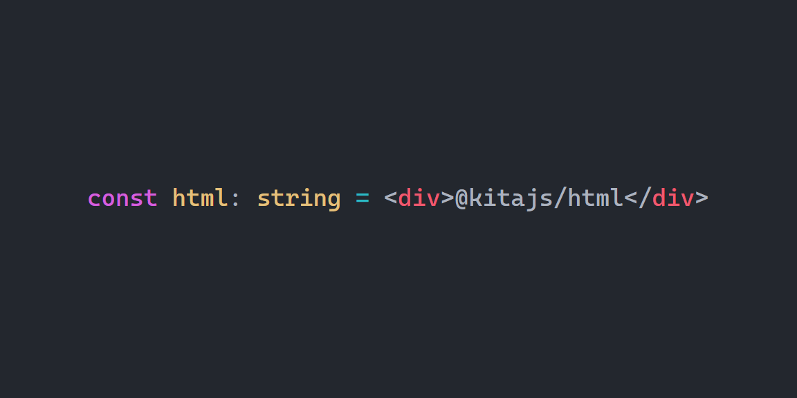

   <b>Using this package?</b> Please consider <a href="https://github.com/sponsors/arthurfiorette" target="_blank">donating</a> to support my open source work ❤️
   
  
   Help @kitajs/html grow! Star and share this amazing repository with your friends and co-workers!
  

 

  

 

  
  
  
  
  
  
  

 
 

<h1>🏛️ Kita Html</h1>

  <code>@kitajs/html</code> is a JSX runtime that renders to plain HTML strings.
   
   

 

- Compiles JSX to string concatenation, with no virtual DOM
- Async components and `Suspense` streaming
- Type definitions for every HTML element, with opt-in HTMX, Alpine.js and Hotwire Turbo
  extensions
- Works with Fastify, Express, Elysia, Hono, Bun, or any code that handles strings

> [!CAUTION] Children are not escaped by default. Run `kita-html check` from
> `@kitajs/html-cli` and use the `safe` attribute for user input, otherwise your
> application is vulnerable to XSS.

Documentation for this package is available at
[html.kitajs.org](https://html.kitajs.org/guide/getting-started).

 

Licensed under the [MIT](LICENSE). Originally forked from
[typed-html](https://github.com/nicojs/typed-html).
