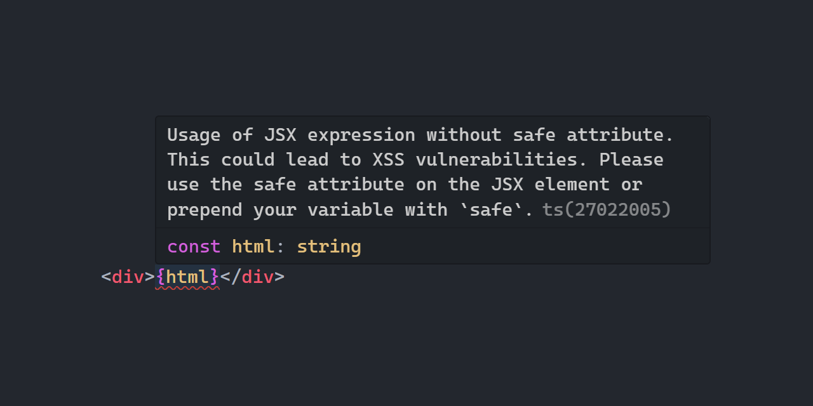

   <b>Using this package?</b> Please consider <a href="https://github.com/sponsors/arthurfiorette" target="_blank">donating</a> to support my open source work ❤️
   
  
   Help @kitajs/ts-html-plugin grow! Star and share this amazing repository with your friends and co-workers!
  

 

  

 

  
  
  
  
  
  
  

 
 

<h1>🏛️ KitaJS TypeScript Html Plugin</h1>

  <code>@kitajs/ts-html-plugin</code> is a TypeScript language service plugin and CLI that finds XSS vulnerabilities in Kita Html JSX.
   
   

 

- Reports unsafe JSX in your editor as you type, through diagnostics TS88601 to TS88604
- Ships the `xss-scan` CLI, which runs the same checks across a project in CI
- `xss-scan` exits with `0` when clean, `1` on errors and `2` on warnings only
- Does not load in editors that use `tsgo`, but `xss-scan` still works

Documentation for this package is available at
[html.kitajs.org](https://html.kitajs.org/guide/getting-started). See also the
[CLI scanner](https://html.kitajs.org/guide/xss/cli-scanner) and
[error codes](https://html.kitajs.org/guide/xss/error-codes) pages.

 

Licensed under the [MIT](LICENSE).
